# Project_template

Это шаблон для решения проектной работы. Структура этого файла повторяет структуру заданий. Заполняйте его по мере работы над решением.

# Задание 1. Анализ и планирование

<aside>

Чтобы составить документ с описанием текущей архитектуры приложения, можно часть информации взять из описания компании и условия задания. Это нормально.

</aside>

### 1. Описание функциональности монолитного приложения

**Управление отоплением:**

- Пользователи могут удалённо включать и выключать отопление через веб-интерфейс
- Система поддерживает отправку команд с сервера на датчик
- Подключить дом к системе можно только через выезд специалиста, сам пользователь этого сделать не может

**Мониторинг температуры:**

- Пользователи могут просматривать только текущую температуру через веб-интерфейс, история показаний не хранится
- Система получает температуру так: сервер опрашивает датчик
- Система поддерживает получение конкретного датчика, создание, изменение и удаление датчиков
- Система поддерживает обновление показания и статуса датчика
- Система поддерживает получение температуры по местоположению

### 2. Анализ архитектуры монолитного приложения

**Язык программирования:** Go \
**База данных:** PostgreSQL \
**Архитектура:** Монолитная, все компоненты системы (обработка запросов, бизнес-логика, работа с данными) находятся в рамках одного приложения. \
**Взаимодействие:** Синхронное, запросы обрабатываются последовательно. \
**Масштабируемость:** Ограничена, так как монолит сложно масштабировать по частям. \
**Развертывание:** Требует остановки всего приложения. 

### 3. Определение доменов и границы контекстов

#### Текущая система

**Домены и их термины:**

- **Управление отоплением**: включить или выключить отопление. Термины: команда, состояние отопления.
- **Мониторинг температуры**: получить текущую температуру. Термины: показание, температура.
- **Управление датчиками**: создать, изменить или удалить датчик. Термины: датчик, тип, местоположение, статус.

**Карта контекстов:**

- Мониторинг температуры берёт у управления датчиками список датчиков, а показания получает у самих датчиков.
- Управление отоплением берёт у управления датчиками, какие датчики есть и где они установлены.

#### Целевая система

**Домены, поддомены и их термины:**

- **Управление устройствами**
    - Поддомен «Команды»: команды отоплению, свету, воротам и будущим устройствам. Термины: команда, состояние устройства.
    - Поддомен «Подключение устройств»: пользователь сам подключает устройство к своему дому. Термины: устройство, модуль, тип устройства, привязка к дому.
    - Поддомен «Устройства партнёров»: работа с устройствами партнёров по стандартным протоколам. Термины: протокол, партнёр.
- **Телеметрия**: сбор показаний, в том числе мониторинг температуры. Термины: показание, датчик, время показания.
- **Видеонаблюдение**: удалённое наблюдение за домом, передача видео. Термины: камера, видеопоток.
- **Сценарии**: получить показания, проверить условие, отправить команду. Термины: сценарий, условие.
- **Пользователи и подписки**: пользователи, их дома и подписки по модели SaaS. Термины: пользователь, подписка, дом.

**Карта контекстов:**

- Сценарии берут показания у телеметрии и отправляют команды через управление устройствами.
- Телеметрия берёт список устройств у управления устройствами, а показания получает от устройств через поддомен «Устройства партнёров».
- Видеонаблюдение берёт список устройств у управления устройствами.
- Управление устройствами берёт у пользователей и подписок, чей это дом и активна ли подписка.

### **4. Проблемы монолитного решения**

- Пользователь не может сам подключить устройство, в системе нет ни домена, ни API для подключения. API создаёт только запись о датчике, а с физическим устройством не связан, поэтому каждое подключение требует выезда специалиста.
- Для поддержки каждого нового типа устройства придётся заново развёртывать всю систему, а развёртывание требует её остановки.
- Вызовы синхронные, сервер сам опрашивает каждый датчик: с ростом числа устройств нагрузка растёт, а масштабирование монолита целиком не даёт достаточного эффекта.

### 5. Визуализация контекста системы — диаграмма С4

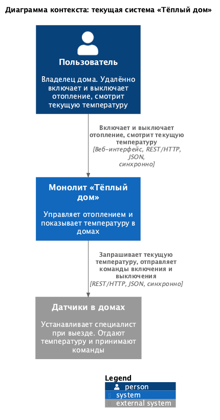

Исходник диаграммы: [schemas/context.puml](schemas/context.puml)

# Задание 2. Проектирование микросервисной архитектуры

В этом задании вам нужно предоставить только диаграммы в модели C4. Мы не просим вас отдельно описывать получившиеся микросервисы и то, как вы определили взаимодействия между компонентами To-Be системы. Если вы правильно подготовите диаграммы C4, они и так это покажут.

**Диаграмма контейнеров (Containers)**

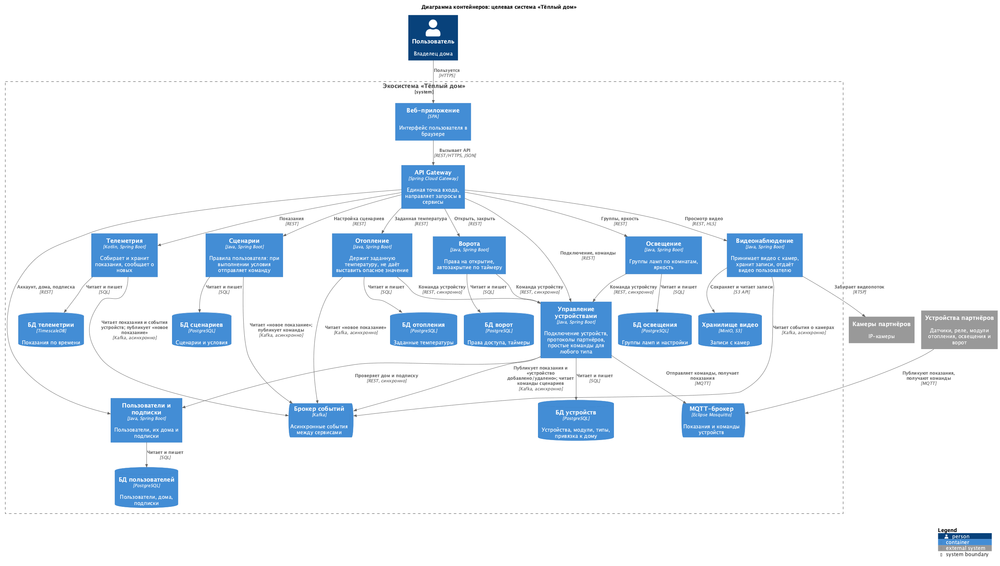

Исходник диаграммы: [schemas/containers.puml](schemas/containers.puml)

**Диаграмма компонентов (Components)**

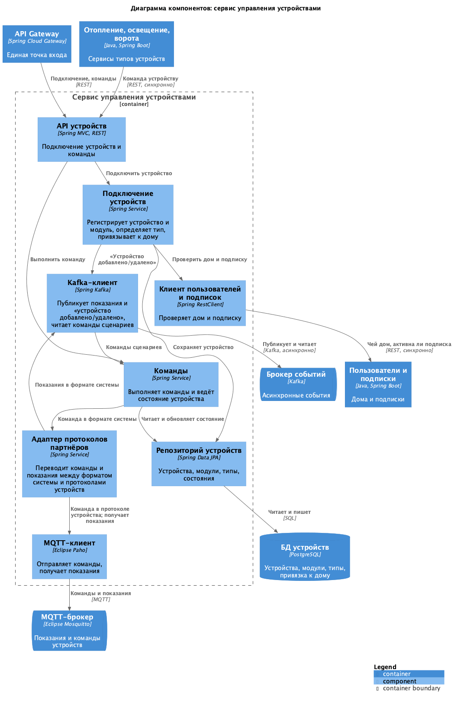

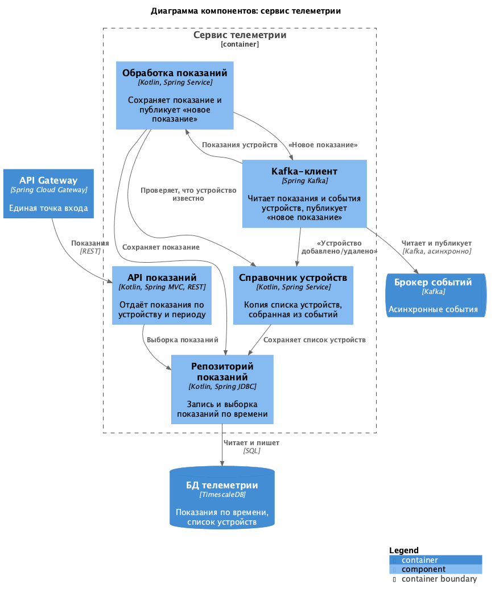

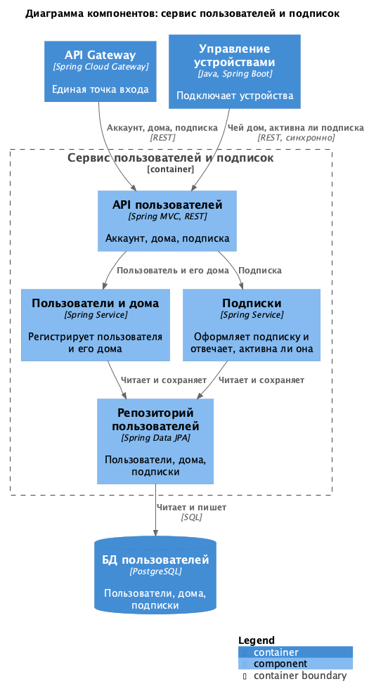

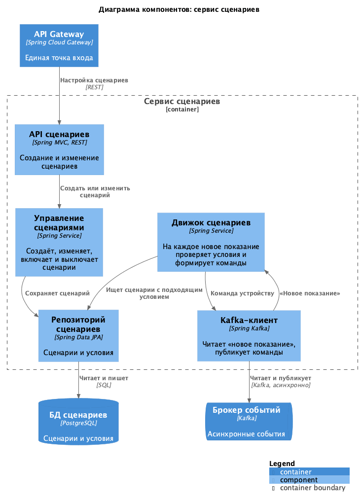

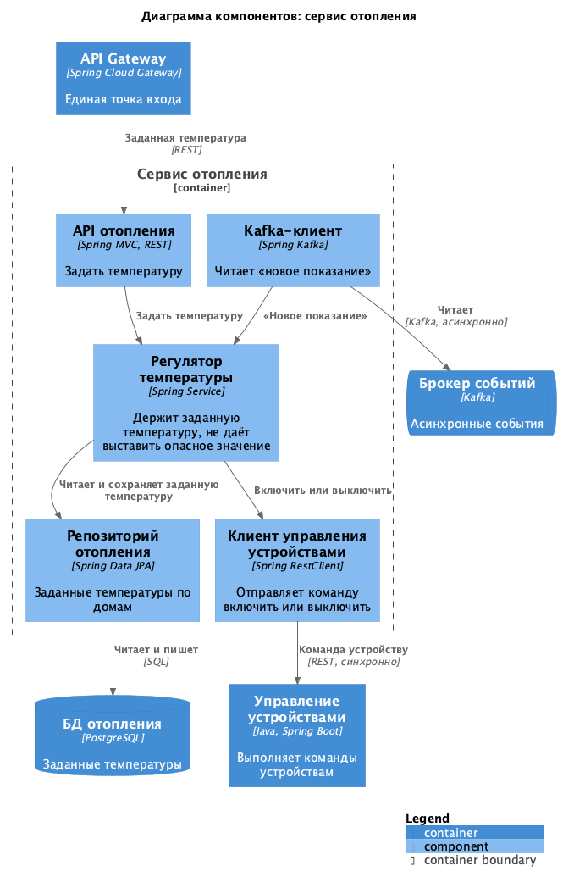

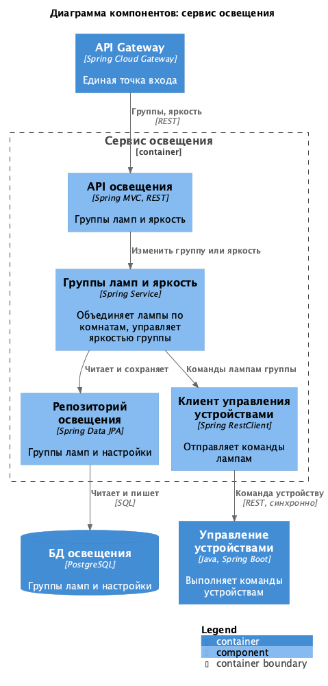

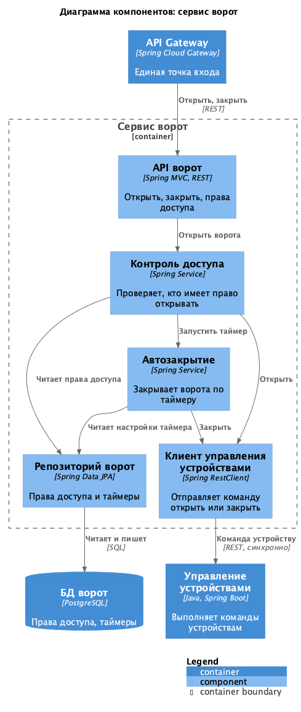

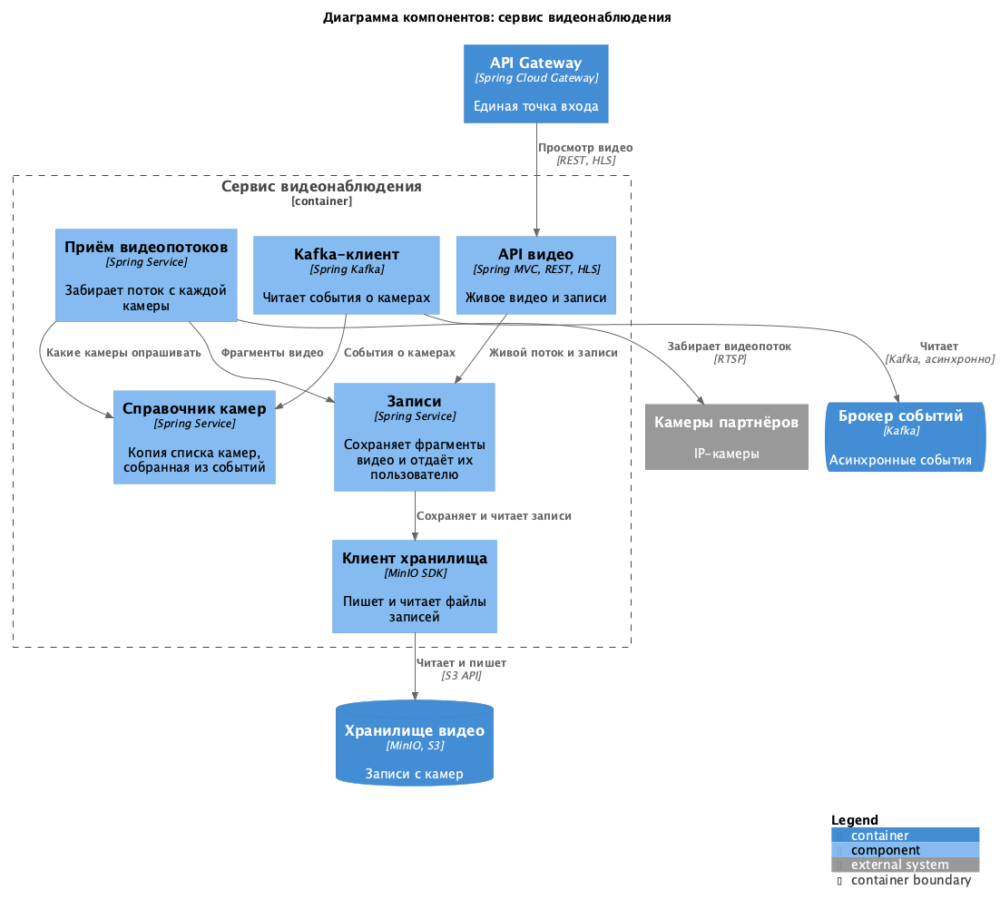

Исходники диаграмм лежат в папке [schemas](schemas), файлы `components-*.puml`.

**Диаграмма кода (Code)**

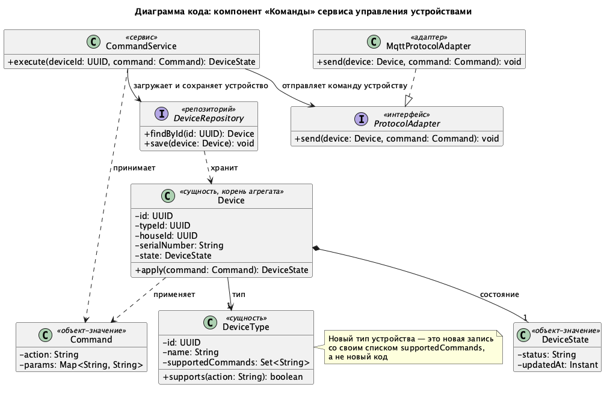

Исходник диаграммы: [schemas/code-commands.puml](schemas/code-commands.puml)

# Задание 3. Разработка ER-диаграммы

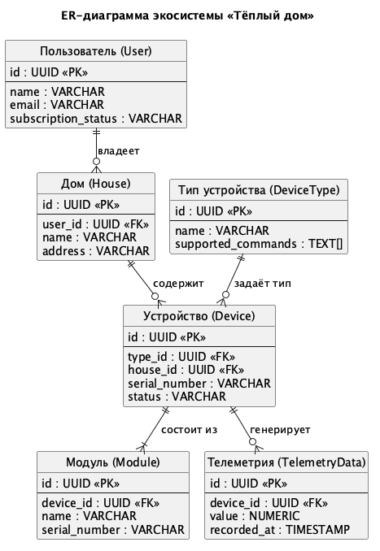

Исходник диаграммы: [schemas/er.puml](schemas/er.puml)

# Задание 4. Создание и документирование API

### 1. Тип API

Укажите, какой тип API вы будете использовать для взаимодействия микросервисов. Объясните своё решение.

### 2. Документация API

Здесь приложите ссылки на документацию API для микросервисов, которые вы спроектировали в первой части проектной работы. Для документирования используйте Swagger/OpenAPI или AsyncAPI.

# Задание 5. Работа с docker и docker-compose

Перейдите в apps.

Там находится приложение-монолит для работы с датчиками температуры. В README.md описано как запустить решение.

Вам нужно:

1) сделать простое приложение temperature-api на любом удобном для вас языке программирования, которое при запросе /temperature?location= будет отдавать рандомное значение температуры.

Locations - название комнаты, sensorId - идентификатор названия комнаты

```
	// If no location is provided, use a default based on sensor ID
	if location == "" {
		switch sensorID {
		case "1":
			location = "Living Room"
		case "2":
			location = "Bedroom"
		case "3":
			location = "Kitchen"
		default:
			location = "Unknown"
		}
	}

	// If no sensor ID is provided, generate one based on location
	if sensorID == "" {
		switch location {
		case "Living Room":
			sensorID = "1"
		case "Bedroom":
			sensorID = "2"
		case "Kitchen":
			sensorID = "3"
		default:
			sensorID = "0"
		}
	}
```

2) Приложение следует упаковать в Docker и добавить в docker-compose. Порт по умолчанию должен быть 8081

3) Кроме того для smart_home приложения требуется база данных - добавьте в docker-compose файл настройки для запуска postgres с указанием скрипта инициализации ./smart_home/init.sql

Для проверки можно использовать Postman коллекцию smarthome-api.postman_collection.json и вызвать:

- Create Sensor
- Get All Sensors

Должно при каждом вызове отображаться разное значение температуры

Ревьюер будет проверять точно так же.


# **Задание 6. Разработка MVP**

Необходимо создать новые микросервисы и обеспечить их интеграции с существующим монолитом для плавного перехода к микросервисной архитектуре. 

### **Что нужно сделать**

1. Создайте новые микросервисы для управления телеметрией и устройствами (с простейшей логикой), которые будут интегрированы с существующим монолитным приложением. Каждый микросервис на своем ООП языке.
2. Обеспечьте взаимодействие между микросервисами и монолитом (при желании с помощью брокера сообщений), чтобы постепенно перенести функциональность из монолита в микросервисы. 

В результате у вас должны быть созданы Dockerfiles и docker-compose для запуска микросервисов. 